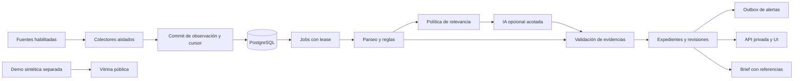

# Arquitectura y modelo de evidencia

Propuesta, no implementación. Mantener Go, React y PostgreSQL; reconstruir las fronteras que hoy mezclan ingest, inferencia y efectos externos.

## Topología

Un monolito modular con un mismo artefacto versionado y modos de ejecución separados: API/UI, workers y colectores. El perfil mínimo puede reunir API y workers; la recolección de riesgo se aísla en proceso/contenedor con credenciales y salida de red propias. PostgreSQL actúa como sistema de registro, cola durable y motor inicial de búsqueda/grafo.

No introducir Redis, Kafka, Neo4j, Elasticsearch ni almacenamiento vectorial en la primera fase. Los adjuntos grandes podrán ir a un almacén de objetos ya disponible, con hash y metadatos en PostgreSQL. No introducirlo hasta que exista un requisito de tamaño/retención concreto.

## Entidades canónicas

| Entidad | Responsabilidad e invariantes |
|---|---|
| `sources` | Identidad estable, política, licencia, clase de privacidad, autenticación referenciada y salud. Alias/URL mutable no es la identidad primaria. |
| `content_blobs` | Payload deduplicado por hash, tamaño, tipo y versión de normalización. Una copia no borra procedencia. |
| `observations` | Aparición en fuente, ID nativo, autor, hora publicada/recolectada, blob y relación de edición/repost. Unique por fuente+ID nativo+revisión; adaptador debe definir identidad cuando no hay ID estable. |
| `evidence_spans` | Observación, revisión/hash, fragmento exacto y offsets sobre representación identificada. Normalización conserva un mapa al original o referencia ambas representaciones. |
| `observables` | Valor sintáctico canónico, tipo y forma original. Existir no implica ser malicioso. |
| `sightings` | Aparición de observable en una observación, spans, rol contextual y fechas. Unique impide recontar reintentos. |
| `entities` / `entity_aliases` | UUID estable; alias con idioma, alcance y evidencia. Fusiones reversibles, sin usar nombre normalizado como identidad definitiva. |
| `assertions` | Afirmación de una fuente o inferencia del sistema, sujeto/predicado/objeto, soporte/contradicción, vigencia, autor del juicio y versión de política. |
| `indicators` | Observable con juicio de uso malicioso, contexto, alcance, fuente, valid_from/valid_until y estado/revocación. No todo observable se promueve. |
| `cases` / `case_events` | Expediente temático con revisiones, novedades, hipótesis, impacto local y referencias. Nombre SQL propuesto: `intelligence_cases` para evitar ambigüedades. |
| `processing_runs` / `jobs` | Versión de código/reglas/prompt/modelo, entradas, resultado, estado operativo y claves idempotentes. |
| `llm_attempts` / `budget_reservations` | Uso y coste real/estimado, máximo reservado, intento, proveedor/modelo resuelto cuando esté disponible y reconciliación. |
| `outbox` / `deliveries` | Eventos de entrega, destinos, intentos y deduplicación. Un informe no se vuelve a enviar solo porque otro worker lo reprocese. |
| `audit_events` | Cambios de política, revisiones, accesos relevantes, exportaciones y decisiones humanas, sin secretos. |

Estos nombres son un contrato de diseño; no se prescribe una tabla por concepto sin revisar transacciones y consultas durante implementación.

## Tres identidades distintas

El mismo texto en canales A y B crea **un contenido y dos observaciones**. Si B copia A, se conserva propagación, pero el conjunto tiene un origen independiente conocido. Si no se sabe la dependencia, se marca `independence_unknown`; no se presume corroboración.

Una IP compartida produce un vínculo factual «aparece en ambos documentos». No demuestra que los autores sean la misma persona ni que la IP sea hostil. La relación semántica y la atribución requieren afirmaciones propias con evidencia y contradicciones.

Una corrección no sobrescribe el juicio anterior: nueva revisión con `supersedes`, motivo y policy_version. Cambiar de modelo permite comparar resultados sin reescribir observaciones originales.

Caché semántica por blob y versión completa del análisis (prompt, esquema, modelo y política). Reasociar spans a cada observación. No reutilizar automáticamente juicios dependientes de autor, fuente, fecha o conversación: el mismo texto puede significar cosas distintas en otro contexto.

## Ingest y trabajos durables

1. Obtener lote acotado desde cursor persistido. Validar identidad, tamaño y política del adaptador.
2. En una transacción: insertar/reutilizar blob, insertar observación/revisión, crear jobs iniciales y confirmar cursor compatible con el lote. Confirmar al adaptador después del commit.
3. Si fuente y base no admiten una transacción conjunta, usar entrega al menos una vez e idempotencia; conservar replay seguro. Nunca avanzar un cursor sobre elementos no persistidos.

Workers reclaman con `FOR UPDATE SKIP LOCKED` en transacción breve, lease con propietario y fencing token. El trabajo externo ocurre fuera del bloqueo; heartbeat y finalización condicionada a lease vigente evitan que un worker antiguo publique un resultado después de perder la propiedad.

Clave de trabajo: `(stage, input_id, input_revision, policy_version, output_schema_version)`. Solo puede existir un resultado vigente por clave. Reintentos conservan identidad lógica y registran intentos separados. No se promete exactly-once de proveedores o webhooks que no implementen idempotencia.

Estados mínimos: `queued`, `leased`, `succeeded`, `retry_wait`, `budget_blocked`, `dependency_blocked`, `quarantined`, `cancelled`. El estado analítico (`irrelevant`, `unknown`, etc.) vive en otro campo. Backoff con jitter, número y edad máximos, reanudación por cambio de condición; una cuarentena tiene causa visible y replay controlado.

## Proyecciones y búsqueda

PostgreSQL full-text, filtros tipados, índices temporales y por observable como inicio. Búsqueda por hash/CVE/IP exacta; texto y aliases para contexto. El grafo es una proyección de afirmaciones: cada arista conserva soporte, tipo y vigencia. Límite de saltos, nodos y tiempo para evitar vistas inoperables.

Embeddings solo como recuperación de candidatos, con medición de recall incremental sobre búsqueda léxica; jamás como prueba de identidad, malicia o atribución. El LLM transforma preguntas en un plan de consulta tipado y validado, ejecutado mediante SQL parametrizado sobre vistas autorizadas.

## Retención y capacidad

Separar retención de payload, metadatos, evidencia seleccionada y logs. Propuesta inicial ajustable: bruto 90 días, expedientes/evidencia referenciada 1 año, telemetría 30 días; ninguna cifra sustituye requisitos de privacidad, licencia o capacidad. Una purga deja tombstone/hash y actualiza referencias sin fingir que el original sigue disponible. No conservar secretos o dumps completos para mejorar métricas.

Estimación ilustrativa: 10.000 observaciones/día × 5 KB de payload medio × 90 días = 4,5 GB de payload bruto. Reservar además índices, JSON, WAL y crecimiento (p. ej. 3–5 veces esa base), más backups fuera del disco primario. Medir tamaño real por observación durante piloto; los 50 GiB del manifiesto actual no constituyen un sizing validado.

Particionar por tiempo solo cuando mediciones de crecimiento, mantenimiento o consultas lo justifiquen. Separar roles de migración, runtime, búsqueda/exportación y backup. Las migraciones nuevas son aditivas, explícitas y verificadas; no ejecutar DDL destructivo desde cada réplica al arrancar.
