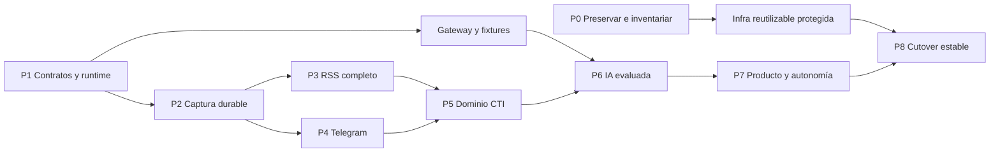

# Roadmap ejecutable del rebuild completo

Fecha: 16-10-2026. Tres revisiones Astra xhigh: implementación/arquitectura, recuperación/Telegram y validación/producto. Este plan desarrolla las tres fases de `09` en **nueve etapas P0–P8**, con paquetes, dependencias y pruebas. El objetivo es sustituir el proyecto operativo completo, no limitarse a reinstalar la imagen actual.

**Estado actual: planificación y lectura de infraestructura.** Ninguna etapa de implementación está terminada. No hay backup verificado, canales resueltos, migración, nuevo runtime ni despliegue realizados. La recuperación no impide empezar desarrollo local con fixtures; sí bloquea cualquier escritura sobre el archivo original o cutover.

## Documentos de ejecución

- [Preservación, infraestructura y canales](12-preservacion-infra-y-canales.md): origen real, copia, restore, inventario y restricciones.
- [Pruebas y gates](13-pruebas-y-gates.md): casos reproducibles, PostgreSQL real, fallos, UI, calidad y evidencias de aceptación.
- [Paquetes de implementación](14-paquetes-de-implementacion.md): encargos concretos con archivos, dependencias y resultados.
- [Arranque, reinyección y cutover](15-arranque-y-cutover.md): secuencia operacional, límites de captura y rollback.
- [Trazabilidad y control de entrega](16-trazabilidad-y-control.md): cobertura de todos los requisitos y definición de rebuild terminado.

Los comandos, paquetes y targets nuevos de estos documentos son **propuestos**, hasta que un paquete los implemente y pruebe. No confundir un nombre de CLI en el plan con una herramienta disponible.

## Arquitectura de transición

Conservar Go/pgx, PostgreSQL, React/Vite, bibliotecas gotd/gofeed y transportes/parsers revisados. Crear runtime v2 con modos API, worker y collector y composición propia, sin llamar al `serve.go` legado. Mantener un solo binario/imagen del proyecto; separación de procesos por privilegios, no microservicios nuevos.

Nueva base `noctis_v2` en PostgreSQL reutilizado, condicionada a espacio y recuperación. Conservar base anterior sin mutaciones del runtime nuevo. Migraciones `migrations/v2/` explícitas, tracker/checksums/lock propios. No cargar tablas del legado con `search_path` ambiguo, no rehacer las migraciones históricas ni dejar que `serve` antiguo ejecute DDL al recuperar.

Los colectores nuevos confirman captura después de persistir identidad, contenido, trabajo y cursor coherente. Un mismo texto puede reutilizar análisis, pero conserva cada aparición. El dominio separa observables, afirmaciones y atribuciones. UI, consultas, presupuesto y alertas consumen esos contratos, no los booleanos antiguos.

## Etapas, dependencias y aceptación

| Etapa | Dependencia | Resultado demostrable | Gate de salida |
|---|---|---|---|
| **P0 Protección e inventario** | Ninguna | Copias recuperables del archivo/sesión, manifest, fuentes inventariadas y capacidad | G0: restauración aislada comprobada; ninguna pérdida o discrepancia sin explicar. |
| **P1 Contratos y runtime v2** | P0 documental; P0 completo para usar infra original | Contratos versionados, migrador propio, configuración validada, build/CI, runtime vacío sin IA | G1: arranque desde cero sin iniciar legacy; roles y migraciones probados. |
| **P2 Captura y ejecución durable** | P1 | RSS, blobs/observaciones/checkpoints, jobs/fencing, fetch restringido | G2: concurrencia/replay/crash con PostgreSQL real; ningún ACK sin commit. |
| **P3 Primer producto RSS completo** | P2 | PIR, parsers, expediente factual, cambios, outbox, brief y UI privada mínima | G3: RSS → interés → evidencia → novedad → aviso → brief, sin IA. **Fase 1 completa.** |
| **P4 Telegram y fuentes reinjectadas** | P2, inventario P0; UI P3 para piloto | Importación idempotente, peers resueltos, dueño único, live/bootstrap separados | G4: fixtures y prueba real autorizada; canales con resultado explícito, cobertura/gaps visibles. |
| **P5 Dominio CTI, feeds y enriquecimiento** | P3, integra P4 | Afirmaciones/contradicción, identidades/dossiers, dependencia, CVE aplicables e indicadores revocables | G5: tres historias de producto y retractación completa, sin falsas corroboraciones. |
| **P6 IA selectiva, gasto y evaluación** | Contratos P1; integración P5 | Gateway simulado/directo autorizado, reservas, pasada única, esquema/citas, selección medida | G6: fallos IA aislados, gasto durable, calidad segmentada y piloto funcional. **Fase 2 / relanzamiento.** |
| **P7 Experiencia y autonomía completas** | P5–P6 | Cinco áreas, búsqueda/QueryPlan, grafo contextual, discovery limitado, atención/revalidación, demo | G7: recorridos privados completos y públicos aislados; utilidad y atención humana medidas. |
| **P8 Operación estable y retirada legacy** | P0–P7 | Restore/rollback/carga ensayados, configuración/docs únicas, release y runtime antiguo desconectado | G8: evidencia operacional y trazabilidad completas. **Fase 3 / rebuild completo.** |

P0 no obliga a detener desarrollo local de P1. P4 y partes de P5/P6 pueden prepararse en paralelo tras contratos, pero sus gates requieren integración real. Seguridad básica, métricas y pruebas comienzan desde P1; P8 certifica operación, no los añade al final.

## Contratos que fijar antes de repartir cambios

| Contrato | Requisito estable |
|---|---|
| `CaptureBatch` / `CommitBatch` | Fuente, identidad nativa/revisión, payload/representación, tiempos, origen y checkpoint esperado/siguiente; recibo post-commit. |
| `EvidenceRef` | Observación/revisión/hash, representación, offsets y unidad explícita; original o indisponibilidad identificable. |
| `JobKey` / lease | Etapa+entrada/revisión+versión de política/esquema; intento/owner/fencing y finalización condicional. |
| `CaseRevision` / `MaterialChange` | Afirmaciones y evidencia afectadas, motivo, política e impacto; creación de outbox atómica. |
| `DeliveryKey` | Destino+expediente+cambio+política; recibo o incertidumbre externa conservados. |
| `SourceManifest` | Fuente/peer y origen del inventario, estado previo, autorización, resolución y referencias privadas separadas. |
| `InferenceGateway` | Capacidades, límites, ruta/modelo, datos permitidos, resultado validado, uso y consumo incierto. |
| `QueryPlan` / API v2 | Operaciones tipadas y parametrizadas, límites, paginación, errores, auth y filtros recuperables por URL. |

Congelar primero un contrato pequeño para objetivos, fuentes, Hoy, expedientes/revisiones, evidencia, búsqueda, salud y atención. Ampliarlo de forma compatible; no diseñar todos los endpoints imaginables antes del primer recorrido.

## Qué significa arrancar limpio

Reinyectar el inventario completo conservando estados: **todos los canales quedan contabilizados**, pero solo los resueltos y autorizados se activan. Descubiertos, pausados, inaccesibles o conflictivos no se reactivan a ciegas.

Crear época operacional nueva y frontera por fuente. Historial y bootstrap tienen cola, cuota y cursor separados; no alimentan «novedades de hoy» ni generan entregas por defecto. No existe cursor fiable legacy que copiar: el nuevo adaptador debe guardar IDs y estado nativo y explicar gaps.

Mantener el histórico recuperado consultable de forma read-only. Importarlo/reanalizarlo selectivamente es una tarea aparte, idempotente y sin alertas. Las correlaciones y clasificaciones antiguas no se importan como hechos confirmados.

## Zrelay y ampliaciones

**X1 Zrelay real:** después de su rebuild y disponibilidad contractual; sustituye adaptador, no dominio. Debe pasar la misma batería de contrato, privacidad, consumo y evaluación. El corte mecánico no depende de IA; el relanzamiento semántico puede usar otra ruta aprobada. Si no existe ruta autorizada, se declara captura mecánica funcional e IA bloqueada, no G6 completado.

**X2 Ampliaciones condicionadas:** STIX/TAXII, OCR, embeddings, SIEM, nuevos conectores y multiusuario tienen paquetes propios posteriores, con utilidad, licencia, presupuesto, amenazas y aceptación. No se eliminan de la visión ambiciosa ni se fingen implementados para cerrar G8.

## Forma de ejecutar el trabajo

Implementar paquetes pequeños y revisar evidencia al cerrar cada uno. Un responsable único del esquema/migraciones. Backend y frontend pueden avanzar con fixtures compartidos tras P1; captura, gateway y UI se integran por los contratos acordados. No crear dos rediseños rivales ni dos escritores de la misma sesión Telegram.

Cada entrega registra código/contratos/políticas, pruebas ejecutadas y omitidas, artefactos saneados, limitaciones y gate alcanzado. Si se crean commits o PR dentro de una tarea autorizada, usar Conventional Commits y descripción/explicación de validación. Este plan no crea commits ni PR.

No asignar fechas ficticias: la recuperación, volumen y sesión efectiva todavía no se han comprobado. Priorizar por dependencias y capacidad, con demo funcional al final de P3, P6 y P8. «La imagen arranca» o «pasan tests unitarios» no bastan para declarar el proyecto reconstruido.
